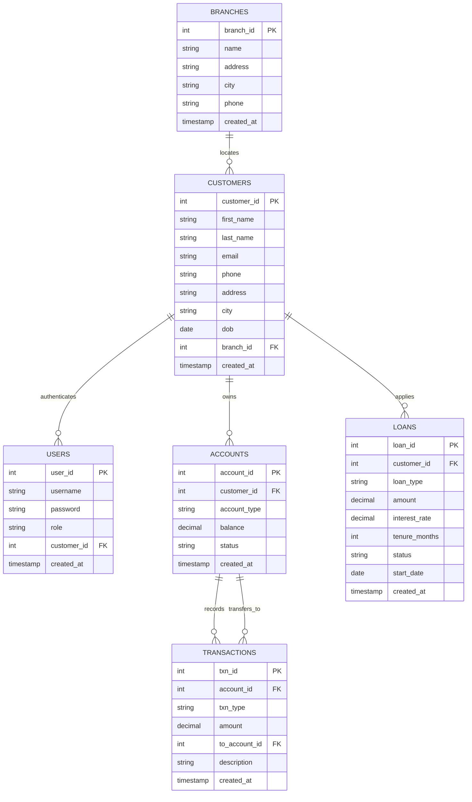

# NexBank - Simple Banking System
**Database Management Systems Project (EGB1221)**  
*Department of Electronics and Communication Engineering*  
*K. Ramakrishnan College of Technology (Autonomous)*  
*Author: Sri Raghavarshan G S (2403811710621109)*

---

## 📌 Project Overview
NexBank is a full-featured, database-driven web application built with **Python (Flask)** and **SQL** (supporting both SQLite out-of-the-box and MySQL). The system implements all core banking concepts and pages described in the project report:

1. **User Management Module (3.1)**: Secure authentication with role-based access control (Admin & Customer).
2. **Account Management Module (3.2)**: Customer creation, account opening (Savings/Current), status toggling (Active/Inactive/Closed), and balance tracking.
3. **Deposit Module (3.3)**: Real-time deposit processing, balance updating, transaction logging, and digital receipt generation.
4. **Withdrawal Module (3.4)**: Real-time withdrawal with strict overdraft validation and error handling.
5. **Fund Transfer Module (ACID)**: Atomic transfers between bank accounts with complete rollback safety in case of errors.
6. **Balance Check Module (3.5)**: Instant balance inquiries, accounts breakdown, and mini-statements.
7. **Loan Management Module**: Complete loan lifecycle (Personal, Home, Auto, Education, Business) with interest calculation, tenure tracking, and status workflows (Pending, Approved, Rejected, Closed).
8. **Branch Management**: Management of physical bank branches and customer distribution.

---

## 📸 Screenshots & UI Compliance
The user interface matches the project report screenshots:
- **Login Page** (Figure 5.1): Clean card layout, default admin credentials banner, and vibrant login button.
- **Dashboard** (Figure 5.3): Metric statistics cards (Customers, Active Accounts, Balance, Transactions, Loans, Branches), real-time transaction ledger with credit/debit indicators, and accounts breakdown progress bars.
- **Customers Page** (Figure 5.4): Customer table with branch details, accounts count, total balance, edit/delete actions, and "+ Add Customer" modal.
- **Branches Page** (Figure 5.5): Branch directory with customer count per branch and branch editing modals.
- **Accounts Page** (Figure 5.6): Account ledger with savings/current badges, status pills, and "+ Open Account" modal.
- **Loan Page** (Figure 5.2): Comprehensive loan tracking with loan types, interest rates, tenures, status badges, and admin approval/rejection actions.

---

## 🗄️ Database Architecture & Relational Schema
The database strictly follows the normalized relational model described in Appendix A (Pages 24–30):



---

## 🚀 How to Run

### Step 1: Activate Virtual Environment
Open your terminal (PowerShell or Command Prompt) and navigate to the project directory:
```powershell
cd C:\Users\srira\.gemini\antigravity\scratch\simple_banking_system
.venv\Scripts\activate
```

### Step 2: Launch the Website
```powershell
python app.py
```
Open your browser and navigate to:
**http://127.0.0.1:5000**

*Note: The SQLite database (`banking.db`) automatically initializes and seeds all 5 branches, 8 customers, 10 accounts, 20 transactions, and 6 loans from the project report upon the very first request.*

---

## 🔑 Login Credentials

| Role | Username | Password | Access Scope |
| :--- | :--- | :--- | :--- |
| **System Administrator** | `admin` | `admin123` | Full control: Add/edit branches, customers, open accounts, approve loans, and monitor all transactions |
| **Customer (John Smith)** | `john` | `password123` | Customer portal: View John's accounts, check balance, deposit/withdraw, transfer funds, view loans |
| **Customer (Sarah Johnson)** | `sarah` | `password123` | Customer portal: View Sarah's accounts, execute banking operations |

---

## 🐬 Running with MySQL (Optional / MySQL Workbench)
If you wish to run the app using a local MySQL server (as specified on Page 24 of the report):
1. Ensure MySQL Server is running on port 3306.
2. In MySQL Workbench, execute `schema.sql` and `seed.sql`.
3. Set the environment variable to enable MySQL mode:
   ```powershell
   $env:USE_MYSQL="true"
   $env:MYSQL_PASSWORD="Parthiban2006@06"   # or your MySQL root password
   python app.py
   ```
